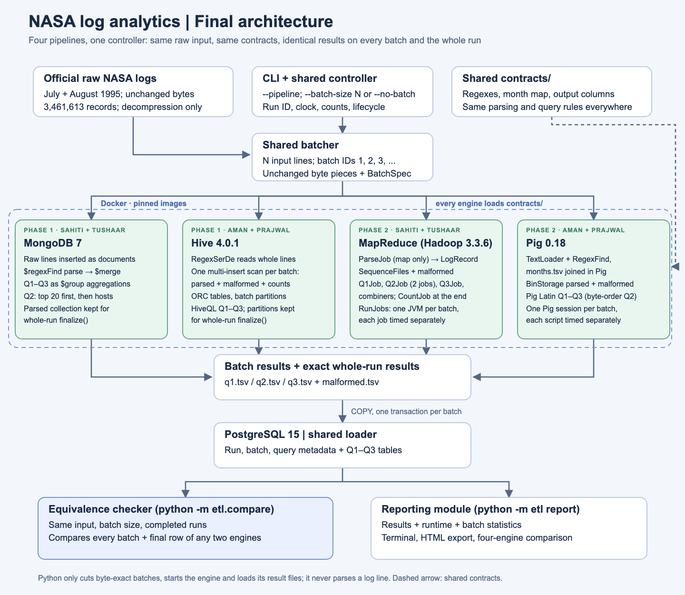

# NASA Log ETL: one workload, four engines

A multi-pipeline ETL and reporting tool for the NASA Kennedy Space Center web server logs (July and August 1995, 3,461,613 lines). The user picks one engine (**Pig**, **MapReduce**, **MongoDB** or **Hive**) and a batch size, or no batching. The tool parses every log line **inside that engine**, runs three fixed queries per batch and for the whole run, loads the results into PostgreSQL, and reports them with the run's runtime and batch statistics.

DAS 839 NoSQL Systems, end-semester project. **Final report:** [report/final_report.pdf](report/final_report.pdf).



## The three queries

| Query | Output |
| --- | --- |
| **Q1** Daily traffic | Per date and status code: requests, total bytes |
| **Q2** Top resources | Top 20 paths by requests: requests, total bytes, distinct hosts |
| **Q3** Hourly errors | Per date and hour: error requests (400–599), total requests, error rate, distinct error hosts |

## How it works

- **The controller** (`etl/`) cuts the input into batches of exactly N lines (or one batch with `--no-batch`). Batches are unchanged byte slices of the logs, so this is not preprocessing. It times the run from the first byte read to the final database commit and checks that every batch's counts add up.
- **The engines** (`etl/engines/`) do all parsing and aggregation; Python never reads a field:
  - **MongoDB:** `$regexFind` parsing, `$group` queries
  - **Hive:** `RegexSerDe` ingestion, HiveQL parsing, ORC tables
  - **MapReduce:** Java jobs: a map-only parse job, then one job per query with combiners
  - **Pig:** `TextLoader` ingestion, `REGEX_EXTRACT_ALL` parsing in Pig Latin, `BinStorage` for the kept rows
- **Contracts** (`contracts/`) are the shared rules every engine loads: the parsing regexes, the month map and the output columns. This is what keeps the engines equivalent.
- **PostgreSQL** (`sql/schema.sql`) stores each batch's results and the whole-run results with run, batch and query metadata; constraints reject inconsistent data.
- **The report** (`python -m etl report`) shows a run's results with its execution metadata, and compares the engines.
- **The equivalence checker** (`python -m etl.compare`) compares two runs of any two engines row by row.

## Results

Every run: 3,461,613 records, 1 malformed line (the truncated last line of the July file).

| Batch size | Batches | MongoDB | Hive | MapReduce | Pig |
| ---: | ---: | ---: | ---: | ---: | ---: |
| 100,000 | 35 | **97.2 s** | 425.1 s | 111.7 s | 261.4 s |
| 500,000 | 7 | 94.8 s | 207.2 s | **65.6 s** | 137.1 s |
| 1,000,000 | 4 | 99.8 s | 171.4 s | **56.6 s** | 128.9 s |
| no batching | 1 | 97.1 s | 149.3 s | **51.2 s** | 114.3 s |

One run each on an Apple M3 Pro with 8 GB for Docker. MongoDB costs the same at any batch size; Hive, Pig and MapReduce pay a fixed cost for every batch (about 8 s, 4.3 s and 1.8 s), so they get faster with bigger batches, and MapReduce is the fastest engine once batches are large. Details: [docs/BENCHMARKS.md](docs/BENCHMARKS.md).

**Equivalence:** at every batch size, including no batching, all four engines give exactly the same Q1, Q2 and Q3 rows for every batch and the whole run (`python -m etl.compare` says EQUIVALENT; `python -m etl report --compare` shows one answer per query), and every run matches the answer key. Details: [docs/VALIDATION.md](docs/VALIDATION.md).

## Quick start

You need Docker Desktop (6 GB+ memory) and Python 3. Full instructions, including Windows: [SETUP.md](SETUP.md).

1. Get the code and the two log files, and unpack them. Never edit the logs.
   ```bash
   git clone https://github.com/sahiti3636/NoSQL_project.git
   cd NoSQL_project && mkdir -p data runs
   curl -o data/NASA_access_log_Jul95.gz https://ita.ee.lbl.gov/traces/NASA_access_log_Jul95.gz
   curl -o data/NASA_access_log_Aug95.gz https://ita.ee.lbl.gov/traces/NASA_access_log_Aug95.gz
   gunzip -k data/*.gz
   ```
2. Start PostgreSQL, MongoDB, Hive and the Pig/MapReduce `hadoop` container, with versions pinned:
   ```bash
   docker compose -f docker-compose.yml -f compose.lock.yml up -d --build --wait --wait-timeout 600
   ```
3. Set up Python and run the checks:
   ```bash
   python3 -m venv .venv
   .venv/bin/python -m pip install -r requirements.txt
   .venv/bin/python -m unittest discover -s tests
   ./tests/smoke/run.sh
   .venv/bin/python scripts/check_phase2.py
   ```
4. Run a pipeline, with and without batching, and see the report:
   ```bash
   .venv/bin/python -m etl run --pipeline pig --batch-size 500000
   .venv/bin/python -m etl run --pipeline pig --no-batch
   .venv/bin/python -m etl report --pipeline pig
   .venv/bin/python -m etl report --compare
   ```

## Commands

| Command | What it does |
| --- | --- |
| `python -m etl pipelines` | List the engines |
| `python -m etl run --pipeline <mongodb\|hive\|mapreduce\|pig> --batch-size <N>` | Run the full ETL with one engine, N lines per batch |
| `python -m etl run --pipeline <...> --no-batch` | Same, with the whole input as one batch |
| `python -m etl report [--run-id ID \| --pipeline P]` | A run's results and metadata (latest successful run by default) |
| `python -m etl report --html FILE` | The full report, every row, as a web page |
| `python -m etl report --list` | Recent runs |
| `python -m etl report --compare` | Runtimes and equivalence across engines and batch sizes |
| `python -m etl.compare --left-run A --right-run B` | Row-by-row check that two runs agree |
| `python scripts/verify_reference.py --run-id ID` | Check a run against the answer key |
| `python scripts/check_phase2_sample.py <pig\|mapreduce>` | Every parsed field and output row of Pig or MapReduce on the edge-case sample |
| `./scripts/run_benchmarks.sh` | Benchmark all four engines at 100k, 500k, 1M and no batching |

## Repository layout

```
contracts/      shared parsing regexes, month map, output columns, controller-engine messages
etl/            controller (runner, batcher, loader, CLI), report, equivalence checker
etl/engines/    mongodb.py, hive.py, mapreduce.py, pig.py, hadoop_common.py,
                reference.py (test-only Python answer key)
mapreduce/src/  MapReduce Java jobs (parse, Q1, Q2, Q3, counts, RunJobs)
pig/src/        Pig Java UDF (byte-order key for Q2 ties)
docker/hadoop/  container for Pig and MapReduce: Hadoop 3.3.6, Pig 0.18.0, JDK 8
sql/            PostgreSQL schema, report views, row-by-row comparison query
reference/      Python reference implementation and expected results
tests/          unit tests, smoke test (2,038 tricky lines), database tests
scripts/        benchmarks, setup checks, reference check, Windows smoke-test launcher
docs/           architecture, one page per engine, benchmarks, validation evidence, sample outputs
report/         final report and Phase 1 report (IEEE format, LaTeX + PDF)
project_handwritten_discussion_architecture/   Phase 1 handwritten design notes
```

## Documentation

- [Final report (PDF)](report/final_report.pdf) · [Phase 1 report (PDF)](report/phase1_report.pdf)
- [Architecture](docs/ARCHITECTURE.md) · [MongoDB](docs/mongodb_engine.md) · [Hive](docs/hive_engine.md) · [MapReduce](docs/mapreduce_engine.md) · [Pig](docs/pig_engine.md)
- [Benchmarks](docs/BENCHMARKS.md) · [Validation](docs/VALIDATION.md) · [Sample outputs](docs/sample_outputs/)
- [Setup](SETUP.md) · [Windows](docs/WINDOWS.md) · [Project summary](PROJECT_SUMMARY.md)

## Team

| Member | Phase 1 | Phase 2 |
| --- | --- | --- |
| Sahiti (BT2024163) | MongoDB ingestion, parsing, malformed records, Q1; controller, batcher, loader | MapReduce ingestion, parsing, malformed records, Q1; benchmark runs |
| Tushaar (BT2024022) | MongoDB Q2 and Q3; equivalence checker, database tests | MapReduce Q2, Q3, whole-run results |
| Aman (BT2024123) | Hive ingestion, parsing, malformed records, Q1 | Pig ingestion, parsing, malformed records, Q1 |
| Prajwal (BT2024245) | Hive Q2, Q3 and whole-run results; reporting module | Pig Q2, Q3, whole-run results |
