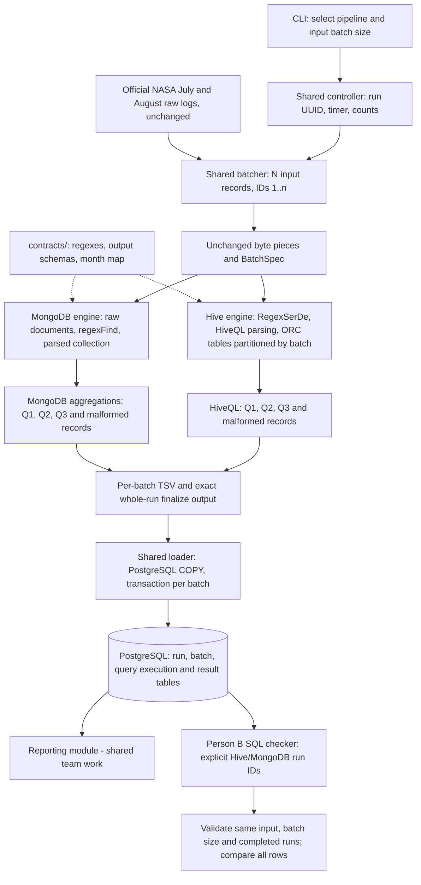

# Phase 1 architecture: MongoDB and Hive

## Responsibilities

- Shared controller/batcher/loader: already supplied by the team. They preserve the raw input,
  create sequential batch IDs, measure runtime through the final SQL commit, enforce record
  counts, record average batch size, and load PostgreSQL results.
- MongoDB Person A: ingestion, parsing using contract regexes, malformed records, Q1.
- MongoDB Person B: Q2, Q3, this architecture diagram, and SQL equivalence checking.
- Hive Person C: raw-line ingestion with RegexSerDe, parsing in HiveQL, malformed records, Q1.
- Hive Person D: Q2, Q3, whole-run finalize and cleanup. Details: [hive_engine.md](hive_engine.md).
- Reporting module (Person D): `python -m etl report` shows a run's results with its execution
  metadata, and can export them as HTML. The equivalence checker is a separate correctness check.

## Q2 and Q3 design

Q2 groups by `(resource_path, host)` to count requests and bytes, then groups by resource path
to sum those counts and count distinct hosts. It sorts by requests descending and path ascending
under explicit simple binary collation, then takes 20 rows (fewer when fewer resources exist).

Q3 groups by `(date, hour, host)` while counting all requests and requests with status 400-599
inclusive. A second grouping by `(date, hour)` sums those counts and counts hosts with at least
one error. Error rate is error requests / all requests. Successful requests stay in the input,
so hours with no errors remain present with zero rate and zero error hosts.

Both queries use MongoDB aggregation with `allowDiskUse=True`. Two-stage grouping avoids
storing every distinct host in one array. Whole-run finalization queries the retained parsed
collection again; summing per-batch distinct counts or per-batch top-20 lists would be incorrect.

## Equivalence

`python -m etl.compare --left-run HIVE_UUID --right-run MONGO_UUID` opens a read-only,
repeatable-read PostgreSQL transaction. It checks completed runs, identical ordered input
manifests and hashes, equal batch size and counts, matching batch boundaries and source pieces,
and complete execution metadata. SQL full outer joins then compare every Q1-Q3 row for every
batch and the final output. Counts and bytes must match exactly; Q3 error rate uses the shared
contract's absolute tolerance `1e-12`. Missing rows fail the check. Malformed lines are compared
as a multiset per batch. Stored fingerprints alone are insufficient: actual table values are checked.

The reference engine is test-only and is not a Phase 1 execution pipeline. It requires explicit
`--allow-reference` in the checker.

**Result (17 Nov 2026, batch size 500,000):** the Hive run and the MongoDB run are **EQUIVALENT**.
Every row of Q1 (614), Q2 (160) and Q3 (2,744) across all 7 batches and the final output matches,
and the malformed records are identical. See [VALIDATION.md](VALIDATION.md).

## Implementation references

- [MongoDB 7 $group and disk spilling](https://www.mongodb.com/docs/v7.0/reference/operator/aggregation/group/)
- [MongoDB binary string comparison](https://www.mongodb.com/docs/manual/reference/bson-type-comparison-order/)
- Assignment: `NoSQL26_ET_project_statement.pdf`, pages 1-3.
- Shared rules: `contracts/README.md`, `contracts/outputs.json`, `sql/schema.sql`.
