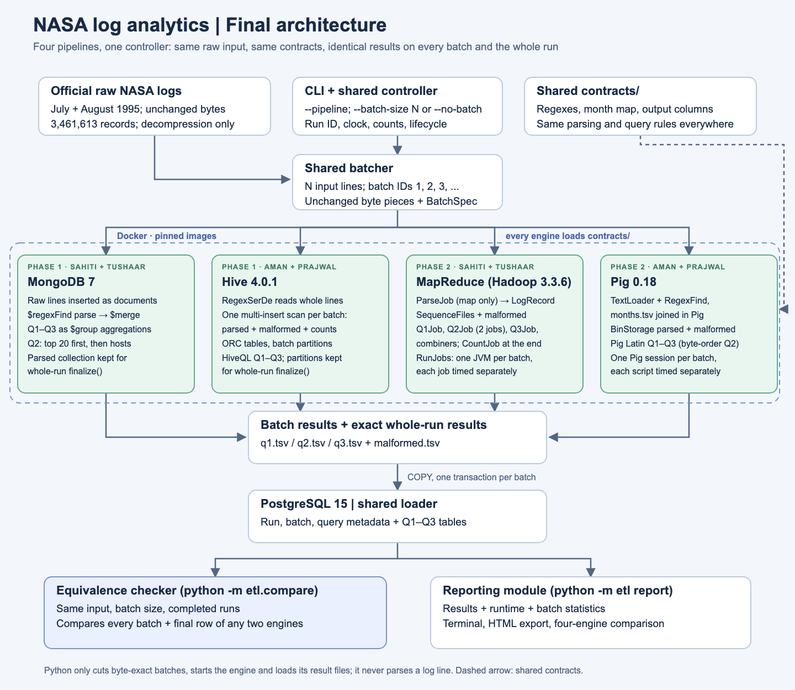
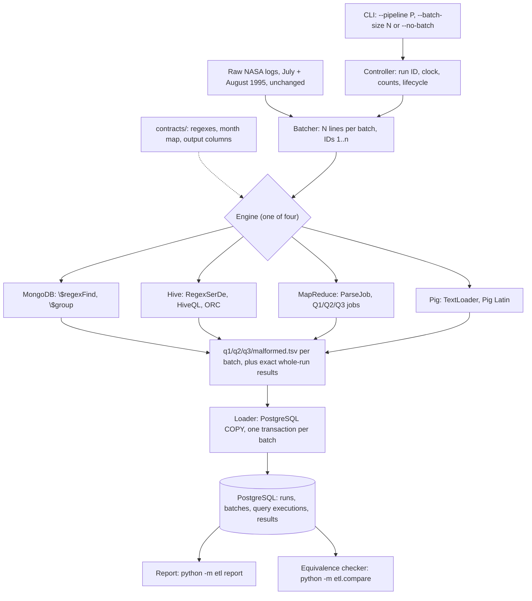

# Architecture

The tool is one Python controller with four interchangeable engines. The user picks exactly one engine and either a batch size or no batching; the controller runs the same ETL flow, and only the engine that parses and queries changes.

## The flow of one run

1. **Start.** `python -m etl run --pipeline <engine> --batch-size <N>` (or `--no-batch`). The controller creates a run ID, records the run as `running` in PostgreSQL, and calls the engine's `prepare()`.
2. **Clock starts** at the first byte read from the logs.
3. **Batch.** The batcher cuts exactly N lines into `runs/<run>/batch_<id>/input/` as unchanged byte pieces (a batch that crosses from July into August has two pieces; the files are never joined). Batch IDs start at 1; only the last batch may be shorter. With `--no-batch` all lines go into batch 1.
4. **Engine.** `process_batch()` loads the raw lines into the engine, parses them there with the shared contract regexes, keeps the parsed and malformed rows for later, and writes this batch's `q1.tsv`, `q2.tsv`, `q3.tsv` and `malformed.tsv`. Python never reads a field.
5. **Check and load.** The controller checks that the engine read exactly the lines it was sent and that valid + malformed = read, then the loader copies the batch's files into PostgreSQL in one transaction.
6. **Whole run.** After the last batch, `finalize()` recomputes Q1–Q3 over all the kept parsed rows (summing per-batch results would get distinct hosts and the top 20 wrong). The loader stores them with `batch_id = NULL`.
7. **Clock stops** after the final PostgreSQL commit. The run is marked `succeeded` with its runtime, record counts, number of batches and average batch size.
8. **Failure.** Any error rolls back the open transaction, marks the run `failed` with the message, and still calls the engine's `cleanup()`. Reports only show successful runs; a retry is a new run.

## The engine interface

Every engine implements the same four methods ([etl/engine.py](../etl/engine.py)):

| Method | Does |
| --- | --- |
| `prepare(run)` | Create this run's tables, collections or folders; compile code if needed. |
| `process_batch(spec)` | Parse one batch inside the engine; write its four output files; return counts and per-step times. |
| `finalize(run)` | Exact whole-run Q1–Q3 over every batch's parsed rows; whole-run counts. |
| `cleanup(run)` | Drop this run's engine data. Never raises. |

## How each engine does it

| | MongoDB 7 | Hive 4.0.1 | MapReduce (Hadoop 3.3.6) | Pig 0.18 |
| --- | --- | --- | --- | --- |
| Ingest | raw lines inserted as documents | `RegexSerDe` external table over the batch folder | `TextInputFormat`, lines end at `\n` only | `TextLoader`, lines end at `\n` only |
| Parse | `$regexFind` aggregation, `$merge` into the parsed collection | one multi-insert scan: parsed + malformed + counts | `ParseJob` (map only) | `REGEX_EXTRACT_ALL('false')`, `months.tsv` joined in Pig |
| Keep for finalize | parsed collection | ORC tables partitioned by batch | `LogRecord` SequenceFiles per batch | `BinStorage` folders per batch |
| Q1 | `$group` | `GROUP BY` | `Q1Job` + combiner | `GROUP` |
| Q2 | top 20 paths, then distinct hosts of those 20 | CTE top 20, join back | `Q2Job`: top-20 job, then hosts job | top 20 in one reducer, replicated join back |
| Q3 | two-stage `$group` | `count(DISTINCT if(...))` | `Q3Job` with mergeable partials | nested `FILTER` + `DISTINCT` |
| Engine docs | [mongodb_engine.md](mongodb_engine.md) | [hive_engine.md](hive_engine.md) | [mapreduce_engine.md](mapreduce_engine.md) | [pig_engine.md](pig_engine.md) |

All four run in Docker with pinned images ([docker-compose.yml](../docker-compose.yml), [compose.lock.yml](../compose.lock.yml)). Pig and MapReduce share the `hadoop` container ([docker/hadoop/Dockerfile](../docker/hadoop/Dockerfile)).

## Shared rules (contracts)

[`contracts/`](../contracts/README.md) holds the rules every engine loads at run time instead of retyping: the envelope, request and fallback regexes, the month map, the output columns and the controller–engine messages. The rules that keep the engines equal:

- A line is valid when the envelope regex matches and its month is in `months.tsv`; anything else is malformed, kept with its raw text and counted, never dropped.
- `log_date`, `log_hour` and `log_timestamp` are sliced from the regex groups. No engine uses date functions (they would convert time zones).
- Missing parts are `''`, never NULL; bytes `-` is 0; counts are 64-bit.
- Q2 ties are broken by the path in UTF-8 byte order; Q3 errors are statuses 400–599, and hours with zero errors keep their row.
- Every output file is PostgreSQL `COPY` text, columns in the order of `outputs.json`.

## Relational schema

[`sql/schema.sql`](../sql/schema.sql), PostgreSQL schema `etl`:

| Table | One row per | Main columns |
| --- | --- | --- |
| `etl_run` | run | pipeline, batch size, status, start/finish, runtime, records (total/valid/malformed), number of batches, average batch size (generated), input hash and manifest |
| `etl_batch` | batch of a run | batch ID, line range, records, valid, malformed, source pieces, time |
| `query_def` | query | Q1–Q3 names |
| `query_execution` | query × batch (and × whole run) | time, row count, SHA-256 fingerprint of the sorted rows |
| `q1_daily_traffic`, `q2_top_resources`, `q3_hourly_errors` | result row | pipeline, run ID, batch ID (NULL = whole run), executed_at, the query's columns |
| `malformed_record` | malformed line | run, batch, raw line |

Constraints reject inconsistent data (valid + malformed = total, `error_rate` = errors / total, one whole-run result set per run via `UNIQUE NULLS NOT DISTINCT`). Views feed the report: `v_run_report`, `v_batch_report`, `v_q1_final`, `v_q2_final` (ranks Q2 with `COLLATE "C"`), `v_q3_final`, `v_pipeline_comparison`, `v_equivalence`. The test-only reference engine is excluded from every report view.

## Equivalence

Two levels, both inside PostgreSQL:

- **Fingerprints:** every query output (per batch and whole run) gets a SHA-256 of its sorted rows (Q3's `error_rate` is left out and checked within 1e-12 instead). `etl.v_equivalence` and `python -m etl report --compare` show how many distinct answers all runs with the same input and batch size produced.
- **Row by row:** `python -m etl.compare --left-run A --right-run B` checks that both runs succeeded on the same input hash and batch boundaries, then compares every Q1–Q3 row of every batch and of the whole run with full outer joins, plus the malformed lines. Any two of the four engines can be compared.

A plain Python implementation (`etl/engines/reference.py`, `reference/reference_results.json`) is the answer key; `scripts/verify_reference.py` checks any run against it. Results: [VALIDATION.md](VALIDATION.md).
