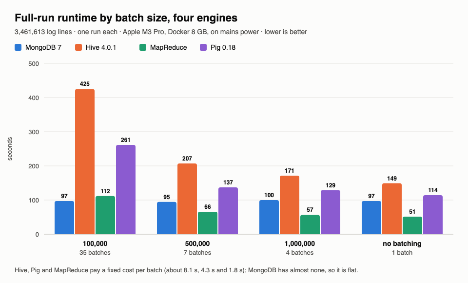

# Benchmarks

## Final comparison: all four engines (25 Nov 2026)

### Setup

| | |
| --- | --- |
| Machine | Apple M3 Pro (11 cores), 18 GB RAM, macOS 15.7, on mains power, Low Power Mode off |
| Docker | 29.5, 11 CPUs and 8 GB memory for all containers |
| Images | MongoDB 7.0.48, PostgreSQL 15.20, Hive 4.0.1 (pinned by `compose.lock.yml`, Hive heap 2 GB); Pig 0.18.0 and Hadoop 3.3.6 local mode with JDK 8 (`docker/hadoop/Dockerfile`, Pig and Hadoop heaps 2 GB) |
| Input | the official July + August 1995 logs, unchanged: 3,461,613 lines |
| Runs | 4 engines × {100k, 500k, 1M, no batching}, one run each, interleaved (batch size → engine), with nothing else running |
| Runtime | measured by the controller, from the first byte read until the last PostgreSQL commit |

Reproduce with `ROUNDS=1 ./scripts/run_benchmarks.sh` (about 45 minutes; the default is 3 rounds). Logs go to `runs/benchmarks/<timestamp>/`.

### Results

| Batch size | Batches | MongoDB | Hive | MapReduce | Pig |
| --- | ---: | ---: | ---: | ---: | ---: |
| 100,000 | 35 | **97.2 s** | 425.1 s | 111.7 s | 261.4 s |
| 500,000 | 7 | 94.8 s | 207.2 s | **65.6 s** | 137.1 s |
| 1,000,000 | 4 | 99.8 s | 171.4 s | **56.6 s** | 128.9 s |
| no batching (3,461,613) | 1 | 97.1 s | 149.3 s | **51.2 s** | 114.3 s |

**Correctness:** all 16 runs succeeded with 3,461,613 records and 1 malformed line, pass `scripts/verify_reference.py` (Q1 295, Q2 20, Q3 1,369 rows, 0 differences), and `python -m etl.compare` reports every engine **EQUIVALENT** to MongoDB at the same batch size, on every batch and the whole run. `python -m etl report --compare` shows one distinct answer per query at every batch size. Details and run IDs: [VALIDATION.md](VALIDATION.md).

### What the numbers say

**1. Three engines pay a fixed cost per batch; MongoDB does not.** A straight-line fit of runtime against the number of batches:

| Engine | Fixed cost per batch | Rest of the run (work) | Per line |
| --- | ---: | ---: | ---: |
| MongoDB | ≈ 0 s | 97 s | 28 µs |
| Hive | **8.1 s** | 143 s | 41 µs |
| MapReduce | **1.8 s** | 51 s | 15 µs |
| Pig | **4.3 s** | 110 s | 32 µs |

Hive, Pig and MapReduce start jobs for every batch: Hive runs four beeline scripts, each compiled into Tez work; Pig compiles each of its four scripts into Hadoop jobs; MapReduce runs five jobs (all in one JVM). Hive pays the most because every script also starts a beeline client. MongoDB runs its aggregations inside a server that is already up.

**2. MapReduce is the fastest engine whenever batches are large.** Hand-written jobs do only the work each query needs: one map-only scan for parsing, combiners that shrink the data before the shuffle, and binary `LogRecord` files read back without re-parsing. At 1M lines per batch and without batching it takes about half of MongoDB's time.

**3. MongoDB is the best choice for small batches.** It is the only engine whose runtime does not grow with the number of batches (97 s at 35 batches, 97 s at 1), so at 100k lines per batch it beats every other engine.

**4. Without batching, every engine is at its fastest except MongoDB, which is unchanged.** One batch removes all per-batch costs: MapReduce 51 s, MongoDB 97 s, Pig 114 s, Hive 149 s. The price is no intermediate results and the highest memory use per batch.

**5. Whole-run results cost about the same at every batch size** (time outside the batches: MongoDB 15–17 s, Hive 14–19 s, MapReduce 18–19 s, Pig 42–44 s). They are computed over all parsed rows, so they do not depend on how the input was cut.

### Effect of the Phase 2 improvements (500,000 lines per batch, same laptop)

| Change | Before | After |
| --- | ---: | ---: |
| MapReduce: one JVM per batch (`RunJobs`) | 72.9 s | 65.6 s |
| Pig: one Pig session per batch, 100 ms job polling, top 20 without a sampling job | 187.8 s | 137.1 s |
| MongoDB: Q2 top 20 first, distinct hosts for those 20 only (whole-run Q2 query time) | 11.2 s | 6.5 s |

The before figures are the Phase 2 code as handed over, run on the same laptop on the same day. Two earlier fixes from Phase 2 development: Hadoop's default 5 s job-completion polling left every MapReduce batch idle for up to 25 s (`Jobs.conf()` now polls every 100 ms); Pig had the same problem with `pig.jobcontrol.sleep`.

### Caveats

- One run per configuration: enough to see the trend (each engine's numbers line up on a straight line against the number of batches), not to give confidence intervals. The Phase 1 history below has 3 rounds for MongoDB and Hive.
- Timing needs an idle machine. An earlier attempt on 25 Nov ran with Low Power Mode on and stray background processes using about 8 CPU cores; every engine was 1.5–10× slower. Those runs were discarded.
- All engines run in local mode inside Docker on one laptop, not on a cluster. Absolute times would differ elsewhere; the shape (fixed cost per batch, MongoDB flat) is the result.

### Run IDs (PostgreSQL `etl.etl_run`)

| Batch size | MongoDB | Hive | MapReduce | Pig |
| --- | --- | --- | --- | --- |
| 100k | `7068b74d-f8a8-4759-abba-a505779a0a78` | `ce9d9ce5-a932-495d-8c41-5c886ac1acff` | `9640ffb3-76ac-49c3-a75e-67efbe6a4d48` | `4501fc44-b11e-4f23-9edd-1e1108e25375` |
| 500k | `08e034fd-4d7d-4fed-8cd4-fa45f0f308f5` | `97571b10-fc4a-49f1-ac5b-927cd70180e1` | `0e1e6acd-ead3-4466-9003-573a44a13a08` | `18ab2f24-0256-43a0-8604-7bf313b03151` |
| 1M | `c0cd3a04-90cb-4ac3-a5b8-e3bde1553960` | `506f88da-2414-4ad1-95a8-c51b86eac87f` | `982aad14-dbde-4ef8-89e5-4907f2b67d59` | `df5db37a-40a5-4a37-872b-336f45d8eadc` |
| none | `3c36925b-4050-42af-bac8-fd9bbe602def` | `c4c8a04a-b25a-4653-958a-0449b321ffdc` | `54ca64c2-97f9-4887-9919-9982041e76e4` | `53580065-e34a-443e-b8a5-7b7316e4aecb` |

Pig was re-run at all four sizes after its driver change (first a Jython driver, now plain Pig `exec`); the earlier Pig runs and the "before" runs of the improvement table were removed from the database. The MongoDB 500k run was repeated: the first one (`ea7989be…`, 131.6 s) overlapped with verification queries running at the same time, so it was removed.

Chart source: [benchmark_runtime.svg](benchmark_runtime.svg).

## Phase 1 history: MongoDB vs Hive (17–18 Nov 2026)

These runs used the Phase 1 engine code (before the MongoDB Q2 rewrite and the timestamp field). They are kept as the Phase 1 record and for their 3-round spread.

#### Setup

| | |
| --- | --- |
| Machine | Apple M3 Pro (11 cores), 18 GB RAM, macOS 15.7 |
| Docker | 29.5, 11 CPUs and 8 GB memory for all containers |
| Images | MongoDB 7.0.48, PostgreSQL 15.20, Hive 4.0.1 (pinned by `compose.lock.yml`), Hive heap 2 GB |
| Input | the official July + August 1995 logs, unchanged: 3,461,613 lines |
| Runs | 3 rounds × 3 batch sizes × 2 engines = 18 runs, 17–18 Nov 2026 |
| Order | interleaved (round → batch size → engine), so slow drift on the laptop hits every configuration equally |
| Runtime | measured by the controller, from the first byte read until the last PostgreSQL commit |

To reproduce: `./scripts/run_benchmarks.sh`. It takes about an hour, and logs go to `runs/benchmarks/<timestamp>/`.

#### Results

| Batch size | Batches | Avg batch size | MongoDB median (min–max) | Hive median (min–max) | Hive ÷ MongoDB |
| --- | ---: | ---: | --- | --- | ---: |
| 100,000 | 35 | 98,903.23 | **104.7 s** (103.0–106.1) | **437.0 s** (400.4–438.2) | 4.2× |
| 500,000 | 7 | 494,516.14 | **106.3 s** (102.4–106.7) | **170.5 s** (163.7–212.3) | 1.6× |
| 1,000,000 | 4 | 865,403.25 | **105.5 s** (103.2–126.8) | **142.7 s** (133.7–145.3) | 1.35× |

**Correctness:** all 18 runs succeeded, each with 3,461,613 records and 1 malformed line. Every run, at every batch size and on both engines, produced the same final Q1, Q2 and Q3 (one SHA-256 fingerprint per query across all 18 runs). `etl.v_equivalence` shows `all_agree = true` for every batch size.

#### What the numbers say

**1. MongoDB doesn't care about batch size, but Hive does.** MongoDB stays at about 105 s whether it gets 35 batches or 4. Hive drops from 437 s to 143 s as the batches get bigger.

**2. The difference is a fixed cost per batch.** Fitting the average batch time against batch size:

| Engine | Fixed cost per batch | Cost per line |
| --- | ---: | ---: |
| MongoDB | ≈ 0 s | 26.5 µs |
| Hive | **≈ 9.1 s** | 26.6 µs |

Both engines do the actual parsing and aggregation work at almost the same speed per line. Hive pays about 9 s extra for every batch, because each batch runs 4 HiveQL scripts (parse, Q1, Q2, Q3), and each one starts a beeline client, compiles the query and launches a Tez job. With 35 batches that adds up to about 5 minutes, and with 4 batches to about 36 s. MongoDB's aggregation pipelines run inside a server that is already up, so starting one costs almost nothing.

**3. Whole-run results also cost Hive more when there are many batches.** Time outside the batches (mostly `finalize()`, the whole-run Q1–Q3) was 37 s for Hive at 100k but 15–16 s at 500k and 1M. Hive's parsed table then has 35 partitions of small ORC files instead of 4–7 larger ones. MongoDB's finalize stays at about 21 s.

**4. Choosing a batch size.** For Hive, larger batches are much better, up to the memory limit. For MongoDB the choice hardly matters for speed, so smaller batches are fine if you want earlier per-batch results.

#### Incidents (reported, not hidden)

- **Hive stalled once.** In round 3, the Hive 1M run (`3340af0e-…`) hung on one Q2 step for over 6 minutes. That step normally takes about 3 s. HiveServer2 was at 550% CPU with memory at its 2 GB heap limit, after about 2.5 hours of non-stop queries. The run was stopped and marked `failed` in `etl.etl_run` with the reason, Hive was restarted, and the configuration was re-run (133.7 s). **Lesson:** a long-running HiveServer2 with a small heap degrades over many queries. For long benchmark sessions, restart Hive between configurations or give it more heap.
- **Outliers.** Hive at 500k in round 3 (212.3 s) and MongoDB at 1M in round 1 (126.8 s) were slower than the other two rounds. The likely cause is the same memory pressure, or other activity on the laptop. The medians are not affected.

#### Caveats

- This is one laptop. Docker on macOS runs Linux in a VM, and Hive runs in local mode inside a single container, not on a cluster. Absolute times would differ on other machines, but the **shape** (MongoDB flat, Hive's fixed cost per batch) is what the comparison shows.
- 3 rounds per configuration is enough to see the trend and the spread, not to give confidence intervals.

#### Run IDs (all stored in PostgreSQL `etl.etl_run`)

| Round | Size | MongoDB | Hive |
| --- | --- | --- | --- |
| 1 | 100k | `e9179a6b-4cfb-47e7-9f61-bef0b3ef6c49` | `69b3b3e9-7916-4325-bbb3-52e79d3e55e0` |
| 1 | 500k | `9796c714-e108-4021-8370-fa8f3cedb24c` | `b689ae47-a5f1-4d1b-97b4-e2c7803b7160` |
| 1 | 1M | `c594495e-937b-4dfb-b069-9de94823848d` | `b1a7f59f-e060-4f5b-ab5a-5ab9654ad2e3` |
| 2 | 100k | `382532c3-1d4c-43e8-8a2f-5e5a93daac14` | `56e74830-44d6-4540-96a1-955461060ebc` |
| 2 | 500k | `90ede3d8-459e-401f-8bc8-4bd837e051a6` | `5232f7c1-aa3d-4703-b9ab-b5ab0c2d4721` |
| 2 | 1M | `0ac0524d-f4dc-449b-a52d-f9fc17b4cdc1` | `10057d3a-f16d-4a7f-99a1-8b9621c5ef33` |
| 3 | 100k | `19ea3fbf-b18c-47da-9fdb-47b5e3b78fde` | `3e29e8e3-a7c0-4bc7-bb43-9583ba41e0b0` |
| 3 | 500k | `b7dd18d2-ab92-46e5-8996-4b11c41b6572` | `114b0df9-90ee-4abc-bf2a-a95c54b80d18` |
| 3 | 1M | `54a20b34-b2b0-447d-b63f-b1fa2ea8c437` | `174f2782-9bba-4d29-bca3-635f7414b170` (re-run; stalled run `3340af0e-8a77-4488-9e2e-c8a12d165beb`) |

## Phase 2: Pig and MapReduce

These runs come from a **different machine** than the Phase 1 table above, so do not compare them with the MongoDB and Hive numbers directly. Before the final report, run all four engines on one laptop: `PIPELINES="mongodb hive pig mapreduce" ./scripts/run_benchmarks.sh`.

| | |
| --- | --- |
| Machine | Linux VM, 2 vCPUs (Intel Xeon 2.1 GHz), 7.8 GB RAM, no Docker |
| Software | Hadoop 3.3.6 and Pig 0.18.0 in local mode on OpenJDK 8 (the versions of the `hadoop` container), PostgreSQL 16 |
| Input | the official July + August logs, unchanged (same `input_sha256` as Phase 1: `7638ea58…`) |
| Runs | 1 round per configuration, 21–22 Nov 2026 |

| Batch size | Batches | Avg batch size | Pig | MapReduce |
| --- | ---: | ---: | ---: | ---: |
| 100,000 | 35 | 98,903.23 | 747.0 s | 369.7 s |
| 500,000 | 7 | 494,516.14 | 371.8 s | 146.0 s |
| 1,000,000 | 4 | 865,403.25 | 301.1 s | 124.5 s |

**Correctness:** every run read 3,461,613 records with 1 malformed line, passed `scripts/verify_reference.py` (Q1 295, Q2 20, Q3 1,369 rows, 0 differences), and `python -m etl.compare` says Pig and MapReduce are **EQUIVALENT** on every batch and the final output at all three batch sizes. `python -m etl report --compare` shows one distinct answer per query.

**Fixed cost per batch.** Both engines behave like Hive: each batch starts several JVMs (Pig: 4 scripts; MapReduce: 5 jobs), so more batches cost more. From the 35-batch and 4-batch runs, each extra batch costs about **14 s for Pig** and **8 s for MapReduce**. Pig is slower per batch because each script also compiles its Pig Latin into a MapReduce plan, and Q2 sorts every path and then joins back to the rows.

**A finding worth reporting: MapReduce was idle half the time.** The first MapReduce runs took 1,084.9 s, 274.7 s and 187.8 s. Every batch took about 29 s whether it held 100,000 or 500,000 lines. The cause was Hadoop's `mapreduce.client.completion.pollinterval`: `Job.waitForCompletion(false)` checks for the end of a job only every 5,000 ms, and a batch runs 5 jobs. `etl.mr.Jobs.conf()` now sets it to 100 ms for every job. Results are unchanged (same fingerprints); runtime fell by 34–66%. Pig is not affected: its job-control loop checks every 500 ms.

Run IDs from that machine (in its own PostgreSQL, not the team database): Pig `2f28b194…` (100k), `4d62cfbb…` (500k), `faf96121…` (1M); MapReduce `7bcfa699…` (100k), `0a4a1210…` (500k), `8972ff95…` (1M).
